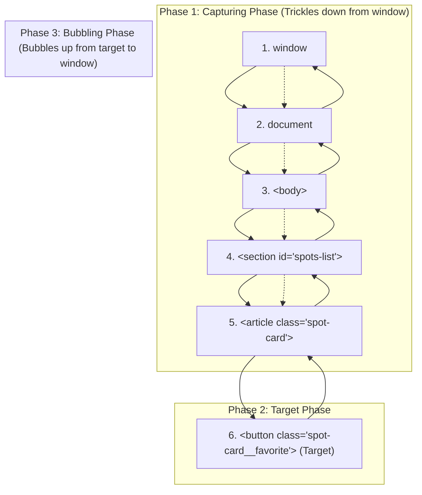
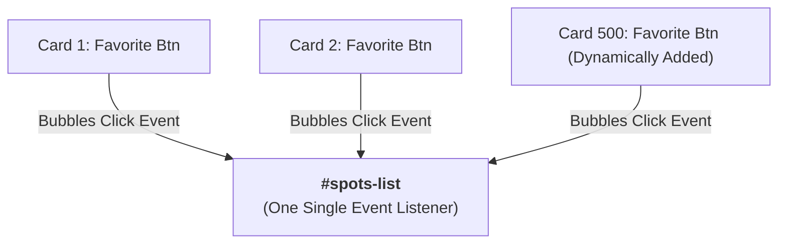
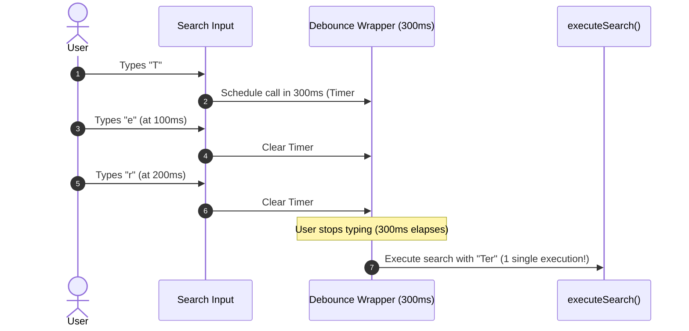

# Week 8: The DOM, Events & Browser APIs

In previous weeks, we updated the UI by overwriting `innerHTML` with template literals. While functional for quick prototypes, this approach exposes two significant vulnerabilities: **performance bottlenecks** (destroying and recreating all DOM nodes on every keystroke) and **Cross-Site Scripting (XSS)** vulnerabilities when handling user input. This week, you master the programmatic **DOM API**, **Event Propagation & Delegation**, **Debounced Search**, and modern **Browser APIs (`FormData`, `crypto.randomUUID`, `IntersectionObserver`)**.

---

## Module 1: The DOM API & Defensive Programming (XSS Prevention)

### 1. The Core Terminology of the DOM API

| Term | What It Actually Means | Technical Context |
| :--- | :--- | :--- |
| **Document Object Model (DOM)** | An object-oriented tree representation of the live HTML document provided by the browser. | Every node in the tree is an instance of the `Node` interface (`Element`, `Text`, `Comment`). |
| **Node vs Element** | A `Node` is any item in the DOM tree (including whitespace text and comments); an `Element` specifically inherits from `Element` (HTML tags). | `element.childNodes` returns all Nodes; `element.children` returns only HTML Elements. |
| **Cross-Site Scripting (XSS)** | A critical security vulnerability where an attacker injects malicious client-side script into web applications rendered to other users. | Occurs when untrusted user input is passed directly to `element.innerHTML` or `eval()`. |
| **`textContent`** | Reads or sets the text content of a node without parsing HTML tags. | Fast and **100% immune to XSS** because HTML markup is treated as harmless literal text. |
| **`innerHTML`** | Parses a string as HTML markup and replaces an element's entire child tree. | Re-triggers HTML tokenization and destroys existing child event listeners. |
| **DocumentFragment** | A lightweight, minimal document object that acts as an off-screen container for DOM nodes. | Used to batch multiple node insertions into a single DOM reflow/repaint operation. |

---

### 2. Under the Hood: The XSS Attack Vector & Prevention

```mermaid
sequenceDiagram
    autonumber
    actor Attacker
    actor Victim
    participant Form as "Add Spot" Form
    participant DOM as Vulnerable DOM (innerHTML)
    participant HackerServer as Attacker's Endpoint

    Attacker->>Form: Submits Description: ``
    Note over Form: Data saved to database or local storage
    Victim->>DOM: Loads Lagos Spots (Card rendered via innerHTML)
    DOM->>DOM: Browser parses &lt;img&gt; tag, fails to load "x", fires onerror
    DOM->>HackerServer: Silently transmits victim's session cookies & tokens!
```

#### Safe DOM Construction vs Vulnerable String Insertion:
```ts
// 🔴 VULNERABLE TO XSS: If user enters `<script>` or `` in description
function renderCardUnsafe(spot: Spot): string {
  return `
    <article class="spot-card">
      <h3>${spot.name}</h3>
      <p>${spot.description}</p>
    </article>
  `;
}

// 🟢 SAFE: Programmatic DOM Construction
function createSpotCardElement(spot: Spot): HTMLElement {
  const article = document.createElement('article');
  article.className = 'spot-card';
  article.dataset.id = spot.id;

  const header = document.createElement('div');
  header.className = 'spot-card__header';

  const title = document.createElement('h3');
  title.className = 'spot-card__title';
  title.textContent = spot.name; // Immune to XSS injection

  const badge = document.createElement('span');
  badge.className = 'spot-card__badge';
  badge.textContent = spot.category;

  header.append(title, badge);

  const desc = document.createElement('p');
  desc.className = 'spot-card__description';
  desc.textContent = spot.description; // Harmless literal text

  const favBtn = document.createElement('button');
  favBtn.className = 'spot-card__favorite';
  favBtn.type = 'button';
  favBtn.setAttribute('aria-label', `Favorite ${spot.name}`);
  favBtn.textContent = '❤️';

  article.append(header, desc, favBtn);
  return article;
}
```

---

## Module 2: Event Propagation, Delegation & Debouncing

### 1. Under the Hood: The 3 Phases of Event Propagation

When a user clicks a button deep inside a card, the browser does **not** simply execute that button's listener in isolation. Events travel in a 3-phase cycle:



1. **Capturing Phase:** The event travels down from `window` through ancestors to the target element.
2. **Target Phase:** The event reaches the actual element clicked (`event.target`).
3. **Bubbling Phase (Default for `addEventListener`):** The event bubbles back up from the target to `window`. **Event Delegation relies entirely on bubbling.**

---

### 2. Event Delegation: Performance & Dynamic Elements

Instead of attaching 500 event listeners to 500 individual cards (which consumes memory and breaks when new cards are dynamically added), **Event Delegation** attaches **one single listener** to the parent container:



```ts
// src/main.ts
const spotsContainer = document.getElementById('spots-list');

spotsContainer?.addEventListener('click', (event: MouseEvent) => {
  const target = event.target as HTMLElement;

  // 1. Identify if a favorite button (or icon inside it) was clicked
  const favoriteBtn = target.closest<HTMLButtonElement>('.spot-card__favorite');
  if (favoriteBtn) {
    event.stopPropagation(); // Prevent card navigation click
    const card = favoriteBtn.closest<HTMLElement>('.spot-card');
    const spotId = card?.dataset.id;
    if (spotId) {
      handleToggleFavorite(spotId);
    }
    return;
  }

  // 2. Identify if the spot card itself was clicked (e.g., to open details)
  const spotCard = target.closest<HTMLElement>('.spot-card');
  if (spotCard) {
    const spotId = spotCard.dataset.id;
    console.log(`Open spot details modal for ID: ${spotId}`);
  }
});
```

- **`event.target`:** The exact, deepest element clicked (e.g., the `<span>` inside the button).
- **`event.currentTarget`:** The element holding the event listener (`#spots-list`).
- **`element.closest(selector)`:** Traverses upward through ancestors until it finds a matching selector.

---

### 3. Under the Hood: Debouncing Frequent Input Events

When a user types into a search input, the `input` event fires on **every single keystroke**. Filtering an array or querying an API on every letter causes unnecessary CPU churn.

**Debouncing** guarantees that a function will only execute after a specified delay has elapsed since the *last time* it was invoked:



#### Generic Debounce Implementation in TypeScript:
```ts
export function debounce<T extends (...args: any[]) => void>(
  func: T,
  delayMs: number
): (...args: Parameters<T>) => void {
  let timeoutId: ReturnType<typeof setTimeout> | undefined;

  return function (...args: Parameters<T>) {
    if (timeoutId) {
      clearTimeout(timeoutId); // Reset countdown timer
    }
    timeoutId = setTimeout(() => {
      func(...args);
    }, delayMs);
  };
}

// Usage in Lagos Spots Search:
const searchInput = document.querySelector<HTMLInputElement>('#search-input');

function handleSearch(event: Event) {
  const query = (event.target as HTMLInputElement).value.trim().toLowerCase();
  const matched = spots.filter(
    (s) => s.name.toLowerCase().includes(query) || s.area.toLowerCase().includes(query)
  );
  renderSpots(matched);
}

searchInput?.addEventListener('input', debounce(handleSearch, 300));
```

---

## Module 3: Form Handling with the `FormData` API

### 1. Intercepting Form Submissions

```ts
const addSpotForm = document.querySelector<HTMLFormElement>('#add-spot-form');

addSpotForm?.addEventListener('submit', (event: SubmitEvent) => {
  event.preventDefault(); // Prevents full page reload

  // 1. Instant extraction of all named fields
  const formData = new FormData(addSpotForm);
  
  const name = formData.get('spotName') as string;
  const category = formData.get('category') as Spot['category'];
  const area = formData.get('area') as string;
  const description = formData.get('description') as string;

  // 2. Client-side validation logic
  if (!name || name.trim().length < 3) {
    showFormError('Spot name must be at least 3 characters long.');
    return;
  }
  if (!description || description.trim().length < 15) {
    showFormError('Description must be at least 15 characters long.');
    return;
  }

  // 3. Assemble new Spot entity with cryptographic UUID
  const newSpot: Spot = {
    id: crypto.randomUUID(), // Native browser UUID generator
    name: name.trim(),
    category,
    area: area.trim(),
    description: description.trim(),
    imageUrl: '/assets/placeholder-spot.jpg',
  };

  // 4. Update in-memory state & re-render
  spots = [newSpot, ...spots];
  renderSpots(spots);
  
  // 5. Reset form inputs
  addSpotForm.reset();
  showFormSuccess('Spot submitted successfully!');
});
```

---

## Module 4: High-Performance Browser APIs: `IntersectionObserver`

Instead of attaching an expensive `window.addEventListener('scroll', ...)` listener that fires 60+ times per second, modern web apps use **`IntersectionObserver`** to detect when elements enter the viewport asynchronously:

```ts
// Lazy-load card images as they scroll into view
const imageObserver = new IntersectionObserver(
  (entries, observer) => {
    entries.forEach((entry) => {
      if (entry.isIntersecting) {
        const img = entry.target as HTMLImageElement;
        const realSrc = img.dataset.src;
        if (realSrc) {
          img.src = realSrc;
          img.classList.remove('opacity-0');
          img.classList.add('opacity-100');
        }
        observer.unobserve(img); // Cease observing once loaded
      }
    });
  },
  {
    rootMargin: '100px', // Pre-fetch image 100px before it enters screen
    threshold: 0.1,
  }
);
```

---

### Common Pitfalls & How to Avoid Them

| Pitfall | Cause | Fix |
| :--- | :--- | :--- |
| **XSS via `innerHTML`** | Concatenating unsanitized user strings into HTML templates. | Use `document.createElement()` and `textContent` for any user-provided string. |
| **Default page reload on form submit** | Missing `event.preventDefault()`. | Call `event.preventDefault()` as the very first line inside the `submit` event listener. |
| **Unbounded scroll/input handler execution** | Firing computationally expensive rendering on every single keystroke/pixel scrolled. | Wrap handler with a 300ms `debounce()` or use `IntersectionObserver`. |
| **Event target misidentification** | Clicking a child `<span>` or `<i>` inside a button causes `event.target` to refer to the span, not the button. | Always use `event.target.closest('button')` to find the enclosing button element. |

---

### Week 8: Comprehensive Assignment

**Objective:** Modernize Lagos Spots' user interaction layer: eliminate XSS vulnerabilities with safe DOM creation, implement event delegation for favorites, debounce real-time search queries, and handle form creation via `FormData`.

**Requirements:**
1. **Defensive DOM Rendering:**
   - Spot cards constructed programmatically using `document.createElement`, `classList`, and `textContent`.
   - Zero raw `innerHTML` string injection of user-supplied properties (`name`, `description`, `area`).
2. **Event Delegation Architecture:**
   - Single delegated `click` event listener on `#spots-list` handling all card favorite toggles via `event.target.closest('.spot-card__favorite')`.
3. **Debounced Real-Time Search:**
   - Search bar input in `#search` that filters spots in real time.
   - Keystroke events debounced by $300\text{ms}$ to prevent unnecessary render cycles.
4. **Form Handling with `FormData` & `crypto.randomUUID()`:**
   - "Add a Spot" form handled via `submit` event with `event.preventDefault()`.
   - Data parsed via `new FormData(form)`.
   - Validation checks for minimum name length ($\ge 3$) and description ($\ge 15$).
   - Valid submissions assigned a unique ID via `crypto.randomUUID()`, appended to state, rendered immediately, and form reset.
5. **Git Workflow:**
   - Developed on branch `feature/dom-events-delegation`, merged via Pull Request, and pulled locally.

---

## Recommended References & Deep-Dive Resources

### Official Documentation & Standards
- [MDN Web Docs: Document Object Model (DOM)](https://developer.mozilla.org/en-US/docs/Web/API/Document_Object_Model) — Complete reference for Node, Element, and Document APIs.
- [MDN Web Docs: Introduction to Events & Bubbling](https://developer.mozilla.org/en-US/docs/Learn/JavaScript/Building_blocks/Events) — The definitive guide to the 3-phase DOM event flow (Capturing, Target, Bubbling).
- [OWASP Cross-Site Scripting (XSS) Prevention Cheat Sheet](https://cheatsheetseries.owasp.org/cheatsheets/Cross_Site_Scripting_Prevention_Cheat_Sheet.html) — Security engineering rules for preventing script injection in DOM applications.
- [MDN Web Docs: IntersectionObserver API](https://developer.mozilla.org/en-US/docs/Web/API/Intersection_Observer_API) — Asynchronous element visibility and viewport intersection detection.

### Recommended Textbooks & Canonical Books
- **DOM Enlightenment** by Cody Lindley (O'Reilly) — *Mastering the Document Object Model using native DOM methods without external libraries.* (Available free online at `domenlightenment.com`).
- **Secrets of the JavaScript Ninja (2nd Edition)** by John Resig, Bear Bibeault, and Josip Maras (Manning) — *Chapters 12–14: DOM manipulation, Event loop mechanics, and Event plumbing.*

### Deep Dives & Performance Guides
- [CSS-Tricks: Debouncing and Throttling Explained Through Examples](https://css-tricks.com/debouncing-throttling-explained-examples/) — Interactive animations demonstrating event firing rates and timing closures.
- [JavaScript.info: Bubbling and Capturing](https://javascript.info/bubbling-and-capturing) — Visual walkthroughs of event propagation and `event.stopPropagation()`.
