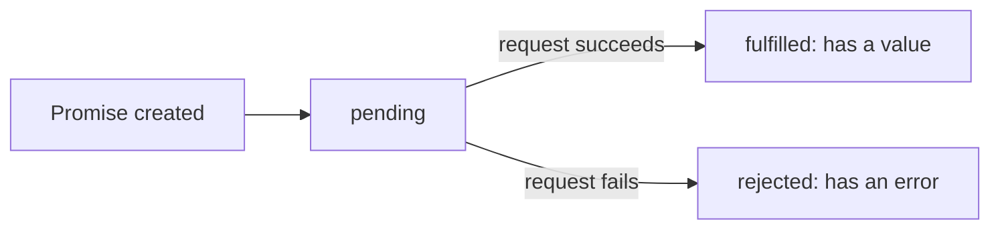

# Week 9: Asynchronous JavaScript & Modern ES6+

Every spot in Lagos Spots so far has been typed in by hand. This week that changes: your app reaches out to a real, free, public API — OpenStreetMap's **Nominatim** geocoding service — and searches actual locations around Lagos as the user types. This is also where your codebase stops being one file and becomes several real modules.

---

## Module 1: The Event Loop & Promises

### 1. Why JavaScript Needs "Async" At All

* **Lecture & Concepts:**
    * JavaScript runs on a **single thread** — one thing at a time. If fetching data from a server took, say, 800ms and ran *synchronously*, the entire page would freeze for 800ms: no clicks, no scrolling, nothing.
    * The **event loop** is what lets JavaScript start a slow operation (like a network request), keep running other code immediately, and come back to handle the result once it's ready — without ever blocking the page.
    * A **Promise** represents a value that isn't available yet, but will be — eventually either **fulfilled** (success) or **rejected** (failure).



### 2. `async`/`await`

* **Lecture & Concepts:**
    * `async`/`await` is syntax that lets asynchronous code *read* like synchronous code, while still not blocking the page. Any function marked `async` implicitly returns a Promise; `await` pauses *that function only* until the awaited Promise settles.
    * `fetch(url)` is the browser's built-in function for making HTTP requests. It returns a Promise that resolves to a `Response` object — you then call `.json()` (itself also async) to read the body as parsed JSON.

* **In-Depth Example (Calling a Real, Free, Keyless API):**
    ```ts
    async function searchLocations(query) {
      const url = `https://nominatim.openstreetmap.org/search?format=json&q=${encodeURIComponent(query)}, Lagos, Nigeria`;
      const response = await fetch(url, {
        headers: { 'Accept-Language': 'en' },
      });
      const results = await response.json();
      return results;
    }
    ```
    * Nominatim is OpenStreetMap's free, public geocoding search — no API key or signup required, which makes it ideal for a learning project. `encodeURIComponent` safely escapes the search term for use inside a URL.

* **Class Exercise: Your First Real Network Call**
    1. Write `searchLocations(query)` exactly as shown.
    2. In the console, run `await searchLocations('Lekki')` (modern DevTools consoles support top-level `await`) and inspect the real array of results that comes back.

---

## Module 2: Error Handling, `Promise.all` & Real Modules

### 1. `try`/`catch` With Async Code

* **Lecture & Concepts:**
    * A network request can fail for real reasons — no internet, the API is down, a bad response. Wrapping `await` calls in `try`/`catch` lets you handle failure gracefully instead of leaving the user staring at a broken page.

* **In-Depth Example (Loading, Error & Success States):**
    ```ts
    async function handleSearch(query) {
      searchStatus.textContent = 'Searching...';

      try {
        const results = await searchLocations(query);
        renderSearchResults(results);
        searchStatus.textContent = results.length ? '' : 'No locations found.';
      } catch (error) {
        console.error('Location search failed:', error);
        searchStatus.textContent = 'Something went wrong. Please try again.';
      }
    }
    ```

* **Class Exercise: Wire Up Real Search-as-You-Type**
    1. Implement `handleSearch` as shown, and `renderSearchResults(results)` to display each result's `display_name`.
    2. Attach an `input` event listener on the search field that calls `handleSearch(event.target.value)`.
    3. Turn off your Wi-Fi briefly and confirm the `catch` block's message actually shows — don't just trust the happy path.

---

### 2. `Promise.all` for Parallel Requests

* **Lecture & Concepts:**
    * Awaiting several independent requests one after another wastes time — each one waits for the previous to finish before starting. `Promise.all([...])` runs multiple Promises **concurrently** and resolves once *all* of them finish, returning their results in the same order.

* **In-Depth Example:**
    ```ts
    async function searchMultipleAreas(areas) {
      const results = await Promise.all(areas.map((area) => searchLocations(area)));
      return results.flat();
    }
    ```

* **Class Exercise: Search Several Areas at Once**
    1. Write `searchMultipleAreas(['Lekki', 'Yaba', 'Ikeja'])` as shown.
    2. Time it (`console.time`/`console.timeEnd`) against calling `searchLocations` three times in sequence with three separate `await`s — confirm `Promise.all` is meaningfully faster.

---

### 3. Real ES Modules

* **Lecture & Concepts:**
    * A single `main.ts` file has grown unwieldy. **ES Modules** let you split code across files, explicitly `export`ing what other files need and `import`ing it where it's used — no global variables leaking between files.

* **In-Depth Example:**
    ```ts
    // src/api.ts
    export async function searchLocations(query) { /* ... */ }
    ```
    ```ts
    // src/storage.ts
    export function loadFavoriteIds() { /* ... */ }
    export function saveFavoriteIds(ids) { /* ... */ }
    ```
    ```ts
    // src/main.ts
    import { searchLocations } from './api';
    import { loadFavoriteIds, saveFavoriteIds } from './storage';
    ```

* **Class Exercise: Split the Codebase**
    1. Create `src/api.ts` (Nominatim search), `src/storage.ts` (favorites persistence), `src/dom.ts` (rendering functions), and keep `src/main.ts` as the thin file that wires them together via event listeners.
    2. Confirm the app still works identically after the split — a passing refactor changes nothing the user can see.

---

## Module 3: A Modern Syntax Sweep

* **Lecture & Concepts:**
    * **Optional chaining (`?.`):** safely reads a nested property that might not exist, short-circuiting to `undefined` instead of throwing — essential once you're reading fields from a real, external API response you don't fully control: `result?.address?.suburb`.
    * **Nullish coalescing (`??`):** already used in Week 6/7 — pairs naturally with optional chaining: `result?.address?.suburb ?? 'Unknown area'`.
    * **Default parameters:** `function search(query, limit = 5) { }` — avoids manual `if (limit === undefined) limit = 5;` boilerplate.
    * **Destructuring in parameters:** `function renderResult({ display_name, lat, lon }) { }` reads straight from the object a caller passes in.

* **In-Depth Example (Real Nominatim Response Handling):**
    ```ts
    function toSpotFromResult(result) {
      return {
        id: crypto.randomUUID(),
        name: result?.name ?? result.display_name.split(',')[0],
        area: result?.address?.suburb ?? result?.address?.city ?? 'Lagos',
        category: 'unverified',
        description: result.display_name,
      };
    }
    ```

* **Class Exercise: Merge Real Search Results Into the App**
    1. Write `toSpotFromResult` exactly as shown, using optional chaining and nullish coalescing to handle Nominatim's inconsistent `address` field.
    2. When a user clicks a search result, convert it with `toSpotFromResult` and merge it into your existing curated `spots` array (dedupe by checking if a very similar name already exists), then re-render.

---

### Week 9: Comprehensive Assignment

**Objective:** Lagos Spots searches real, live locations via the Nominatim API, merged with your curated spots, with proper loading/error handling and a modular codebase.

**Requirements:**

1. **Real API Call:** `searchLocations(query)` correctly calls Nominatim and returns parsed JSON.
2. **Async UI States:** Search shows a "Searching..." state, a "No locations found" state, and a real error state (tested by actually disabling your network).
3. **Modules:** The codebase is split into at least `api.ts`, `storage.ts`, `dom.ts`, and `main.ts`, using real `import`/`export`.
4. **Modern Syntax:** `toSpotFromResult` uses optional chaining and nullish coalescing to safely handle a real, occasionally-missing API field.
5. **Merging:** Selecting a real search result adds it to the visible spots list without breaking existing favorites/filtering.
6. **Git:** Committed and pushed via the branch → PR → merge workflow.

**Bonus Challenge:** Add a simple debounce (delay firing `handleSearch` until the user stops typing for ~300ms) so you're not sending a real network request on every single keystroke — a genuine, common production concern when calling any third-party API from user input.
