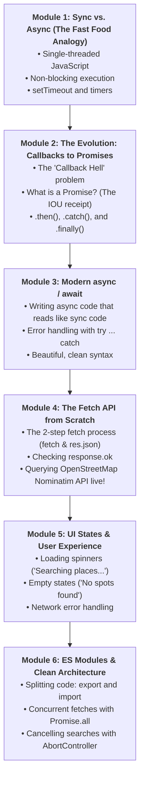
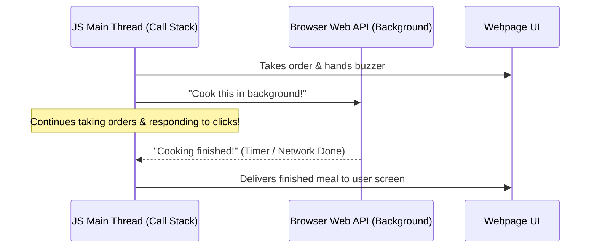
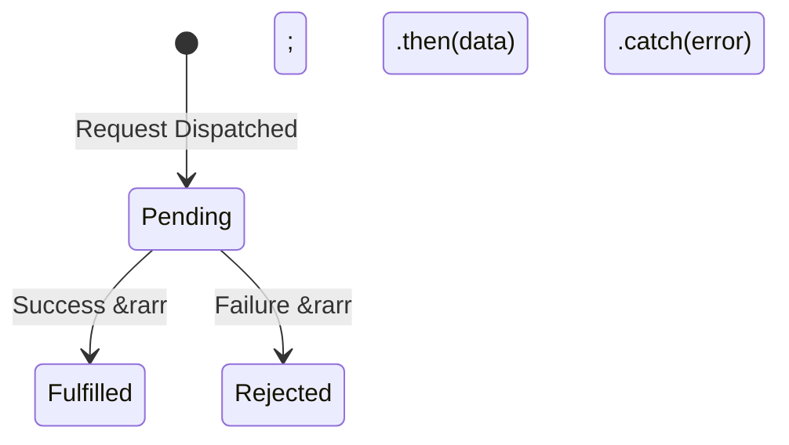
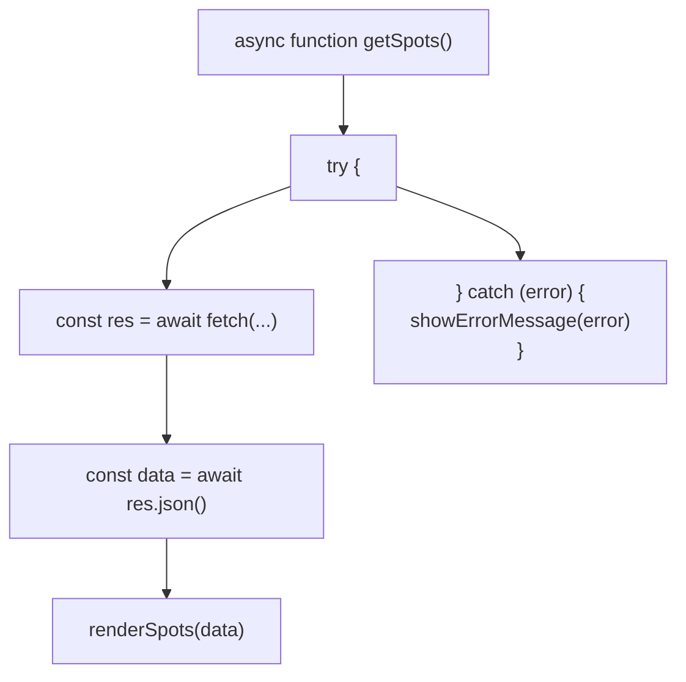
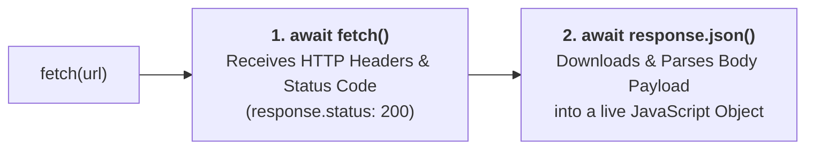
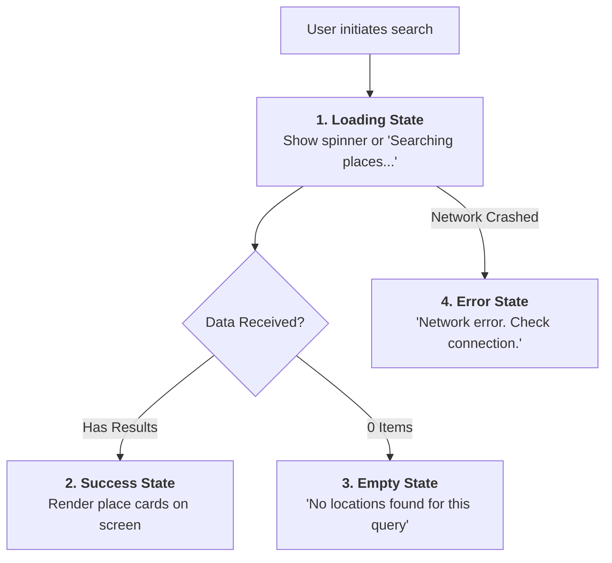

# Week 9: Asynchronous JavaScript & Modern ES6+

Welcome to Week 9! In Weeks 6, 7, and 8, you mastered JavaScript variables, functions, data structures, and the DOM. Everything we built worked with data already in memory or typed into a form.

However, real-world applications don't keep all their data inside the browser. In the real world:
- Instagram fetches new posts from a server.
- Uber tracks real-time car coordinates across the city.
- **Lagos Spots** queries live maps and place locations from OpenStreetMap.

Talking to a server takes time: network packets travel across continents, and connections can be fast, slow, or drop entirely. If JavaScript waited synchronously for every network request, your entire webpage would **freeze and become completely unresponsive**.

This week, you master **Asynchronous JavaScript**: the engine that keeps web apps snappy and responsive while fetching data from the live internet.

---

## Pedagogical Roadmap



---

## Module 1: Synchronous vs. Asynchronous (The Fast Food Analogy)

### 1. The Single-Threaded Chef

> [!NOTE]
> **The Mental Model:** JavaScript is **single-threaded**. It has only **one chef** in the kitchen (called the **Call Stack**). That chef can only chop one tomato, fry one egg, or stir one pot at a time.

- **Synchronous (Blocking) Code:** 
  Imagine the chef puts a pot of jollof rice on the stove to cook for 45 minutes, and stands there staring at the pot without doing anything else. The whole restaurant stops, customers get angry, and no new orders can be taken!
- **Asynchronous (Non-Blocking) Code:** 
  The chef puts the pot on the stove, sets a timer, and gives the customer an **order buzzer**. While the rice cooks in the oven (the background Web API), the chef continues serving other customers. When the buzzer rings, the chef plates the meal. The kitchen never freezes!



---

### 2. Proof with `setTimeout()`

```js
console.log("1. Ordering food...");

// setTimeout delays execution without blocking the rest of the script:
setTimeout(() => {
  console.log("3. Order is ready! (Arrived after 2 seconds)");
}, 2000); // 2000 milliseconds = 2 seconds

console.log("2. Chatting with friends while waiting...");
```

#### Console Output:
```
1. Ordering food...
2. Chatting with friends while waiting...
3. Order is ready! (Arrived after 2 seconds)
```
Notice that line 2 ran **immediately** while the timer was counting down in the background!

---

## Module 2: The Evolution: Callbacks to Promises

### 1. The Problem with Callbacks ("Callback Hell")

In early JavaScript, asynchronous operations used **callback functions**. If you needed to do three sequential actions (e.g., login $\to$ fetch spots $\to$ fetch reviews), your code quickly formed an unreadable, deeply nested triangle known as the **Pyramid of Doom**:

```js
// 🔴 The Old "Callback Hell" (Hard to read, hard to debug):
loginUser(email, (user) => {
  getUserSpots(user.id, (spots) => {
    getSpotReviews(spots[0].id, (reviews) => {
      renderReviews(reviews, () => {
        console.log("Finally finished!");
      });
    });
  });
});
```

---

### 2. What is a Promise? (The IOU Receipt)

> [!TIP]
> **The Mental Model:** A **Promise** is like an electronic buzzer at a fast-food counter or a laundry collection ticket. It promises that you will get a result in the future.
> 
> A Promise is always in one of **three states**:
> 1. **`Pending`:** The request is in flight (the kitchen is cooking).
> 2. **`Fulfilled` (Resolved):** Success! You received your meal (data). Handled with `.then()`.
> 3. **`Rejected`:** Failed! The kitchen ran out of gas or the network dropped. Handled with `.catch()`.



```js
// Consuming a Promise with .then() and .catch():
fetch("https://jsonplaceholder.typicode.com/posts/1")
  .then((response) => {
    return response.json(); // Parse the response body as JSON
  })
  .then((data) => {
    console.log("Post Title:", data.title);
  })
  .catch((error) => {
    console.error("Network request failed:", error);
  })
  .finally(() => {
    console.log("Request finished (whether it succeeded or failed).");
  });
```

---

## Module 3: Modern `async` and `await`

While `.then()` chains were a big upgrade over callbacks, ES2017 introduced **`async` and `await`**. This allows you to write asynchronous code that looks and reads like clean, synchronous line-by-line instructions.

### 1. The Golden Rules of `async` / `await`
1. You can only use `await` inside a function marked with **`async`**.
2. `await` pauses execution of that specific function until the Promise settles, but **does NOT freeze the browser tab**.
3. Always wrap `await` calls in a **`try ... catch`** block to handle errors gracefully.



```js
async function fetchSinglePost() {
  try {
    const response = await fetch("https://jsonplaceholder.typicode.com/posts/1");
    const post = await response.json();
    console.log("Post Title:", post.title);
  } catch (error) {
    console.error("Could not load post:", error);
  }
}

fetchSinglePost();
```

---

## Module 4: The Fetch API from Scratch

### 1. The Two-Step Fetch Process

When querying an API using `fetch(url)`, beginners are often surprised to find they must `await` twice:



```js
async function loadData() {
  // Step 1: Request headers & status arrive
  const response = await fetch("https://api.example.com/data");

  // Step 2: The actual JSON text stream is downloaded and parsed
  const data = await response.json();
  
  return data;
}
```

---

### 2. The `response.ok` Quirk

> [!CAUTION]
> **The Most Common Fetch Trap:** `fetch()` does **NOT** throw an error on `404 Not Found` or `500 Server Error`! As long as the server responds with a status code, the Promise considers the network request "successful".
> 
> **You must always check `response.ok` manually:**

```js
async function loadUserData(userId) {
  try {
    const res = await fetch(`https://api.example.com/users/${userId}`);

    // If HTTP status is NOT in the 200-299 range:
    if (!res.ok) {
      throw new Error(`Server returned error status: ${res.status}`);
    }

    const userData = await res.json();
    return userData;
  } catch (error) {
    console.error("Failed to load user:", error.message);
  }
}
```

---

### 3. Real-World Live API: Querying OpenStreetMap (Nominatim)

Instead of fake mock data, let's query the live, free **OpenStreetMap Nominatim Geocoding API** to search for real locations in Lagos:

```js
async function searchLagosPlaces(searchTerm) {
  // 1. Sanitize the query string:
  const query = encodeURIComponent(`${searchTerm}, Lagos, Nigeria`);
  const url = `https://nominatim.openstreetmap.org/search?format=json&q=${query}&limit=5`;

  try {
    const response = await fetch(url, {
      headers: {
        "Accept-Language": "en",
        // OpenStreetMap requires a descriptive User-Agent:
        "User-Agent": "LagosSpotsSchoolApp/1.0"
      }
    });

    if (!response.ok) {
      throw new Error(`Failed with status: ${response.status}`);
    }

    const places = await response.json();
    return places;
  } catch (error) {
    console.error("Geocoding failed:", error);
    return []; // Return safe empty array on failure
  }
}

// Try searching for places:
searchLagosPlaces("Ikeja").then(results => {
  results.forEach(place => {
    console.log(`📍 ${place.display_name} (Lat: ${place.lat}, Lon: ${place.lon})`);
  });
});
```

---

## Module 5: UI States & User Experience (UX)

When writing real web applications, you must design for the three states of network data:



### Complete Lagos Spots Search Feature with UI States:

```js
const searchInput = document.querySelector("#search-input");
const statusMessage = document.querySelector("#status-message");
const resultsContainer = document.querySelector("#results-container");

searchInput.addEventListener("change", async (e) => {
  const query = e.target.value.trim();
  if (!query) return;

  // 1. Show Loading State:
  statusMessage.textContent = "⏳ Searching places in Lagos...";
  resultsContainer.innerHTML = "";

  try {
    const results = await searchLagosPlaces(query);

    // 2. Handle Empty State:
    if (results.length === 0) {
      statusMessage.textContent = `❌ No places found matching "${query}". Try another area.`;
      return;
    }

    // 3. Handle Success State:
    statusMessage.textContent = `Found ${results.length} locations:`;
    
    results.forEach(place => {
      const card = document.createElement("article");
      card.className = "p-3 bg-white rounded shadow border mb-2";
      card.innerHTML = `
        <h4 class="font-bold text-slate-800">${place.name || query}</h4>
        <p class="text-xs text-slate-500">${place.display_name}</p>
        <span class="text-xs text-orange-600 font-semibold">Coordinates: ${place.lat}, ${place.lon}</span>
      `;
      resultsContainer.append(card);
    });

  } catch (error) {
    // 4. Handle Error State:
    statusMessage.textContent = "⚠️ Unable to connect to map services. Please check your internet connection.";
  }
});
```

---

## Module 6: ES Modules & Clean Architecture

### 1. Splitting Code with `import` and `export`

As projects grow, keeping all your JavaScript in one 1,000-line `script.js` file becomes a nightmare. Modern JavaScript allows you to organize code into separate **modules**:

```
project/
├── index.html
├── src/
│   ├── api.js       <-- Network queries (searchLagosPlaces)
│   ├── storage.js   <-- localStorage favorites logic
│   ├── dom.js       <-- Card rendering and UI helpers
│   └── main.js      <-- Main coordinator and event listeners
```

#### Step 1: Exporting from `src/api.js`:
```js
// src/api.js
export async function searchLagosPlaces(searchTerm) {
  // ... fetch code here ...
}
```

#### Step 2: Importing into `src/main.js`:
```js
// src/main.js
import { searchLagosPlaces } from "./api.js";

searchLagosPlaces("Lekki").then(data => console.log(data));
```

#### Step 3: Enabling Modules in `index.html`:
```html
<!-- Note type="module" -->
<script type="module" src="./src/main.js"></script>
```

---

### 2. Parallel Requests with `Promise.all()`

If you need to fetch data for multiple neighborhoods at the same time:
- **Sequential (Slow):** Waiting for Ikoyi (500ms), then waiting for VI (500ms), then waiting for Lekki (500ms) = **1500ms total**.
- **Parallel (Fast):** Firing all three requests at once using `Promise.all()` = **~500ms total**!

```js
async function loadTopNeighborhoods() {
  console.time("Parallel Load");

  // All 3 requests start at the exact same moment:
  const [ikoyi, vi, lekki] = await Promise.all([
    searchLagosPlaces("Ikoyi"),
    searchLagosPlaces("Victoria Island"),
    searchLagosPlaces("Lekki")
  ]);

  console.timeEnd("Parallel Load");
  console.log("Ikoyi results:", ikoyi.length);
  console.log("VI results:", vi.length);
  console.log("Lekki results:", lekki.length);
}
```

---

## Module 7: Rookie Traps & Debugging Guide

| Error Message / Trap | What Caused It | How to Fix It |
| :--- | :--- | :--- |
| `SyntaxError: await is only valid in async functions` | You typed `await` inside a regular function without the `async` keyword. | Add `async` to the enclosing function declaration: `async function myFunc()`. |
| `Promise { <pending> }` logged to console | You logged a Promise directly without `await`ing its result. | Put `await` before the async function call: `const data = await getPlaces();`. |
| Uncaught (in promise) Error crashes page | A network request failed and you didn't have a `try/catch` block. | Always wrap `await fetch()` in `try { ... } catch (err) { ... }`. |
| `Failed to load module script: Access to script blocked by CORS` | You opened your HTML file using `file:///` in the browser instead of a local web server. | Run a local server (like the VS Code Live Server extension, or `npx serve`). |

---

## 🎯 Week 9 Hands-on Classroom Exercises

### Level 1: Warmup with Timers & Promises
1. Create a function `delayedGreeting(name, delayMs)` that returns a Promise which resolves with `"Hello, [name]!"` after `delayMs` milliseconds.
2. Call the function using `async/await` and log the output.

### Level 2: Fetching Sample Data
1. Use `fetch()` to query `https://jsonplaceholder.typicode.com/users`.
2. Extract the data into an array of user objects using `await response.json()`.
3. Loop through the users and display their `name`, `email`, and `city` inside a styled `<ul>` on your page.

### Level 3: Real Lagos Spots Geocoding Search
1. In your `lagos-spots` project, wire your search bar to the Nominatim OpenStreetMap API.
2. When the user types an area in Lagos (e.g., "Surulere", "Yaba", "Victoria Island"), show a loading spinner or indicator.
3. Fetch the top 3 matching places and render them as interactive cards.
4. When the user clicks on a search result card, display its coordinates (`lat` and `lon`) on the screen!

---

## 📚 Curated Deep-Dive References

* [JavaScript.info: Promises](https://javascript.info/promise-basics) — The best visual and intuitive guide to JavaScript Promises.
* [JavaScript.info: Async/await](https://javascript.info/async-await) — Step-by-step masterclass on async/await syntax and error catching.
* [The Valley of Code: Asynchronous JavaScript](https://thevalleyofcode.com/javascript/asynchronous) — Flavio Copes' gentle, beginner-focused asynchronous guide.
* [MDN Web Docs: How to use Promises](https://developer.mozilla.org/en-US/docs/Learn/JavaScript/Asynchronous/Promises) — Comprehensive Mozilla tutorial.
* [MDN Web Docs: Fetch API](https://developer.mozilla.org/en-US/docs/Web/API/Fetch_API/Using_Fetch) — Authoritative reference on requests, headers, and json parsing.
* [OpenStreetMap Nominatim Search API](https://nominatim.org/release-docs/latest/api/Search/) — Official OpenStreetMap query parameters and documentation.
