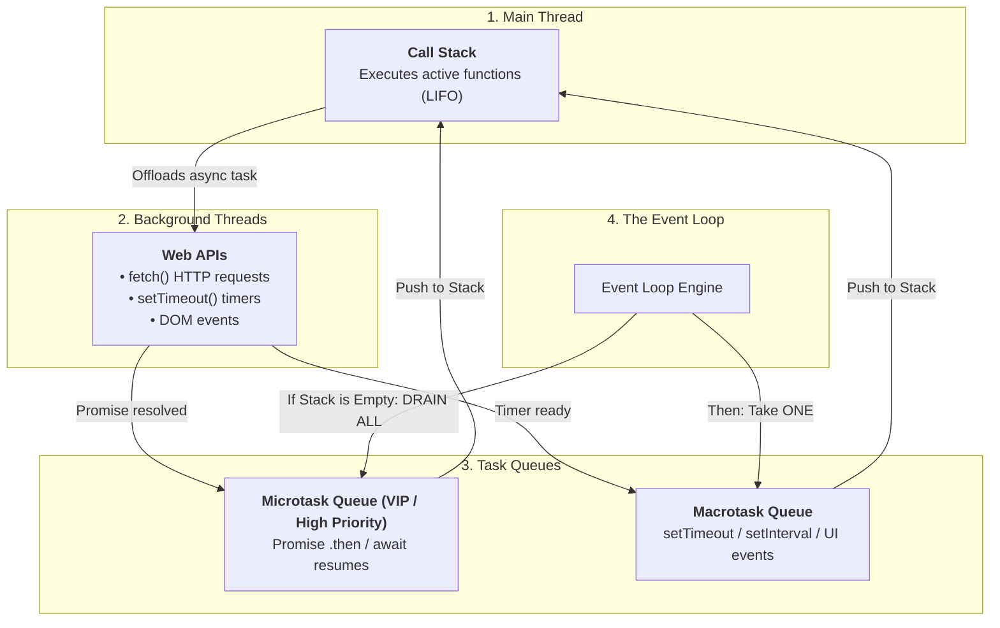
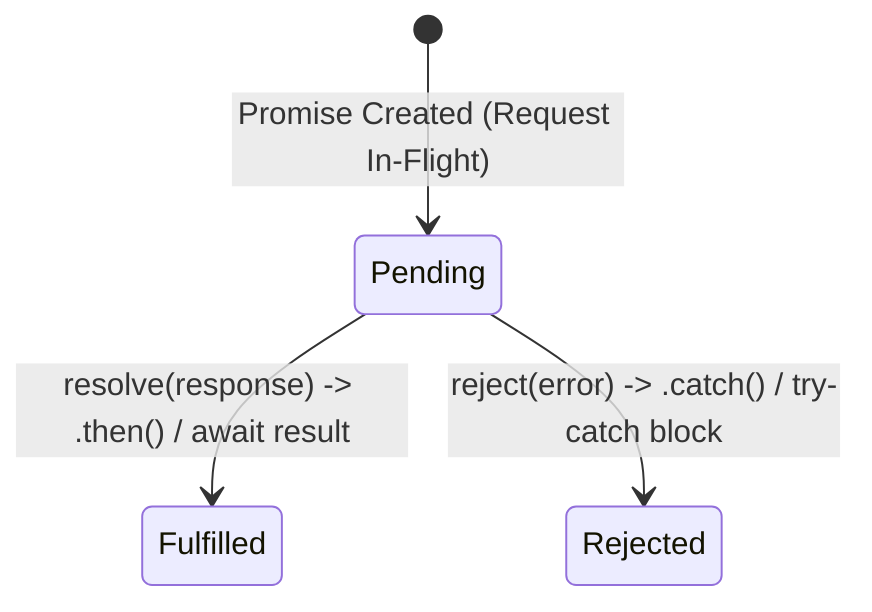
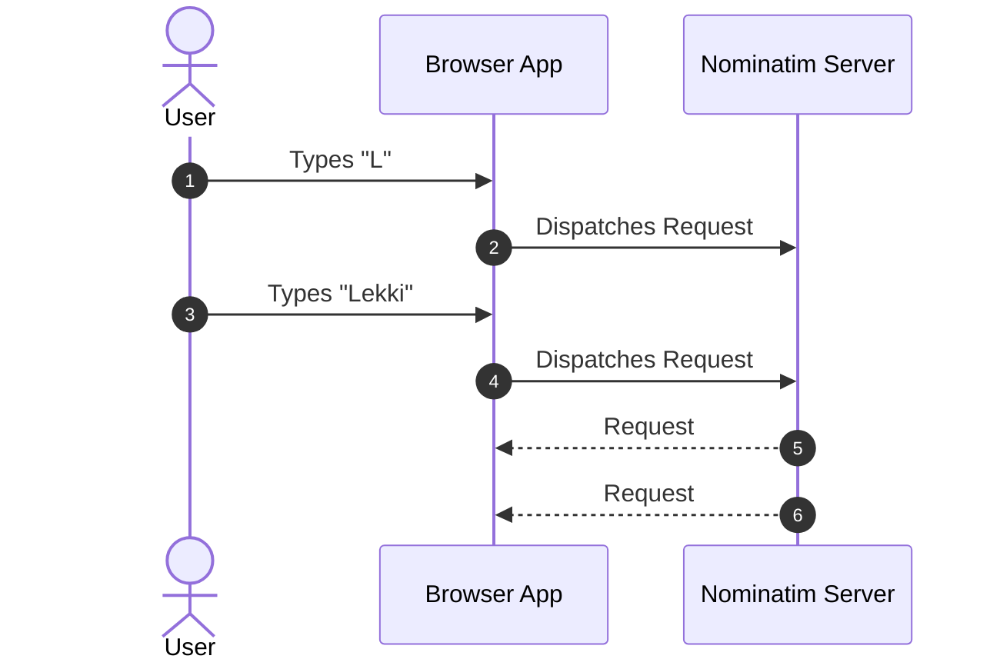

# Week 9: Asynchronous JavaScript & Modern ES6+

Until now, Lagos Spots has operated entirely on local, hardcoded mock data. This week, your application connects to the live web: querying real geospatial coordinates and places using OpenStreetMap's **Nominatim Geocoding API**. To accomplish this reliably, you master the asynchronous execution model of JavaScript: **The Event Loop (Call Stack, Web APIs, Microtask vs. Macrotask Queues)**, **Promises**, **`async`/`await`**, **Race Condition Prevention with `AbortController`**, and modular code organization via **ES Modules**.

---

## Module 1: The JavaScript Event Loop & Asynchronous Mechanics

### 1. The Core Terminology of Asynchronous JavaScript

| Term | What It Actually Means | Technical Context |
| :--- | :--- | :--- |
| **Single-Threaded** | JavaScript executes on a single main execution thread, processing one task at a time on its Call Stack. | Long-running synchronous calculations freeze the browser window (UI becomes unresponsive). |
| **Non-Blocking I/O** | Delegating slow I/O operations (network requests, disk access, timers) to browser background threads (Web APIs) so the main thread remains responsive. | JavaScript registers a callback and continues executing subsequent lines immediately. |
| **The Event Loop** | A continuous runtime coordination loop that monitors the Call Stack and task queues, pushing completed async callbacks onto the Call Stack when it becomes empty. | Dictates the exact deterministic order in which synchronous and asynchronous code executes. |
| **Microtask Queue** | High-priority queue reserved for **Promise callbacks (`.then`, `.catch`, `await` resumes)** and `queueMicrotask()`. | Drained **completely to empty** before the browser renders or processes any macrotask. |
| **Macrotask (Task) Queue** | Standard queue for **`setTimeout`**, **`setInterval`**, DOM events, and I/O callbacks. | The event loop processes **one macrotask at a time** before re-checking the microtask queue. |
| **Promise** | An object representing the eventual completion (fulfillment) or failure (rejection) of an asynchronous operation. | Solves "Callback Hell" by providing composable, chainable async workflows. |

---

### 2. Under the Hood: The Event Loop & Execution Priority



#### Event Loop Execution Order Trace:
```ts
console.log('1. Synchronous Start');

setTimeout(() => {
  console.log('4. Macrotask (setTimeout)');
}, 0);

Promise.resolve().then(() => {
  console.log('3. Microtask (Promise)');
});

console.log('2. Synchronous End');
```

**Console Output:**
1. `1. Synchronous Start` (Stack)
2. `2. Synchronous End` (Stack finishes synchronous script)
3. `3. Microtask (Promise)` (Event loop prioritizes and drains Microtask Queue before Macrotask Queue)
4. `4. Macrotask (setTimeout)` (Event loop takes next Macrotask)

---

## Module 2: The Fetch API, Promises & `async`/`await`

### 1. Under the Hood: The 3 States of a Promise



1. **`Pending`:** Initial state; neither fulfilled nor rejected.
2. **`Fulfilled`:** The operation completed successfully; produces a value.
3. **`Rejected`:** The operation failed (e.g., DNS failure, network dropped); produces an error reason.

---

### 2. The Fetch API & The `response.ok` Quirk

> [!WARNING]
> **The Most Common `fetch` Trap:** `fetch()` does **NOT** reject a Promise when an HTTP server returns an error status like `404 Not Found` or `500 Internal Server Error`. A `fetch` Promise **only rejects on physical network failures** (e.g., disconnected internet, DNS failure, CORS block).

To handle HTTP errors properly, you must explicitly check `response.ok` (which is `true` for HTTP status codes in the range `200`–`299`):

```ts
// src/api.ts

export interface NominatimLocation {
  place_id: number;
  lat: string;
  lon: string;
  display_name: string;
  name: string;
  address?: {
    suburb?: string;
    city?: string;
    state?: string;
    country?: string;
  };
}

export async function searchLocations(query: string, signal?: AbortSignal): Promise<NominatimLocation[]> {
  const sanitizedQuery = encodeURIComponent(`${query.trim()}, Lagos, Nigeria`);
  const endpoint = `https://nominatim.openstreetmap.org/search?format=json&addressdetails=1&q=${sanitizedQuery}`;

  try {
    const response = await fetch(endpoint, {
      signal, // Enables request cancellation
      headers: {
        'Accept-Language': 'en',
        'User-Agent': 'LagosSpotsApp/1.0', // OpenStreetMap requires a descriptive User-Agent
      },
    });

    // Explicitly check HTTP Status 200-299
    if (!response.ok) {
      throw new Error(`HTTP Error ${response.status}: ${response.statusText}`);
    }

    const data: NominatimLocation[] = await response.json();
    return data;
  } catch (error: any) {
    if (error.name === 'AbortError') {
      console.log('Search request was aborted by user input.');
      return [];
    }
    console.error('Failed to fetch locations from Nominatim:', error);
    throw error; // Re-throw to let UI display error banner
  }
}
```

---

### 3. Preventing Network Race Conditions with `AbortController`

When a user types "L-E-K-K-I" into a search box, multiple network requests are dispatched in rapid succession. Due to network latency variability, **Request #1 ("L") may arrive *after* Request #5 ("Lekki")**, overwriting the latest search results with stale data:



#### The Professional Solution: `AbortController`
```ts
// src/main.ts
let activeAbortController: AbortController | null = null;

async function handleLiveSearch(query: string) {
  if (query.trim().length < 2) {
    renderSpots(spots);
    return;
  }

  // 1. Abort previous in-flight request if user is still typing
  if (activeAbortController) {
    activeAbortController.abort();
  }
  activeAbortController = new AbortController();

  const statusEl = document.getElementById('search-status');
  if (statusEl) statusEl.textContent = 'Searching Lagos locations...';

  try {
    const results = await searchLocations(query, activeAbortController.signal);
    
    if (results.length === 0) {
      if (statusEl) statusEl.textContent = 'No matching places found.';
      return;
    }

    if (statusEl) statusEl.textContent = '';
    renderApiSearchResults(results);
  } catch (error: any) {
    if (error.name !== 'AbortError') {
      if (statusEl) statusEl.textContent = 'Network error. Please check your connection.';
    }
  }
}
```

---

## Module 3: Parallel Execution & Modern ES6+ Features

### 1. Concurrency: `Promise.all` vs `Promise.allSettled`

| Method | Execution Behavior | Failure Behavior |
| :--- | :--- | :--- |
| **`Promise.all([p1, p2, p3])`** | Runs all promises **concurrently**. | **Fail-Fast:** Rejects immediately if *any single* promise rejects, discarding other results. |
| **`Promise.allSettled([p1, p2, p3])`** | Runs all promises **concurrently**. | **Never Rejects:** Waits for *all* promises to settle and returns an array of objects: `{ status: 'fulfilled', value }` or `{ status: 'rejected', reason }`. |

```ts
// Fetch multiple neighborhood spots concurrently in parallel:
async function loadNeighborhoods(neighborhoods: string[]) {
  console.time('Parallel Fetch');
  
  // All 3 network requests fire at the same instant
  const results = await Promise.all(
    neighborhoods.map((area) => searchLocations(area))
  );
  
  console.timeEnd('Parallel Fetch'); // ~300ms total (instead of 300ms x 3 = 900ms sequential)
  return results.flat();
}
```

---

### 2. Modern ES6+ Defensive Syntax

#### Optional Chaining (`?.`) & Nullish Coalescing (`??`):
When consuming unpredictable third-party API data, optional chaining stops fatal `TypeError: Cannot read properties of undefined` crashes:

```ts
// Safe extraction from dynamic API responses
function transformApiResultToSpot(result: NominatimLocation): Spot {
  const primaryName = result?.name || result?.display_name?.split(',')?.[0] || 'Unnamed Spot';
  const neighborhood = result?.address?.suburb ?? result?.address?.city ?? 'Lagos';

  return {
    id: `osm-${result.place_id}`,
    name: primaryName.trim(),
    category: 'study', // Default categorization
    area: neighborhood,
    description: result.display_name,
    imageUrl: '/assets/placeholder-spot.jpg',
  };
}
```

---

## Module 4: Modular Architecture with ES Modules (ESM)

Organize the application into single-responsibility ES Modules:

```
src/
├── types.ts          # Shared TypeScript interfaces (Spot, Category)
├── api.ts            # External Nominatim network calls & error handling
├── storage.ts        # localStorage read/write with JSON validation
├── dom.ts            # Programmatic DOM node generation & sanitization
└── main.ts           # Orchestrator / Event Listeners & Application State
```

```ts
// src/types.ts
export interface Spot {
  id: string;
  name: string;
  category: 'food' | 'study' | 'nightlife' | 'events';
  area: string;
  description: string;
  imageUrl: string;
  isFavorite?: boolean;
}

// src/main.ts
import { Spot } from './types';
import { searchLocations } from './api';
import { getStoredFavoriteIds, toggleFavoriteId } from './storage';
import { createSpotCardElement } from './dom';
```

---

### Common Pitfalls & How to Avoid Them

| Pitfall | Root Cause | Fix |
| :--- | :--- | :--- |
| **Assuming `fetch` rejects on 404/500** | `fetch` resolves on any completed HTTP response. | Always check `if (!response.ok) throw new Error(...)`. |
| **Race conditions on rapid typing** | Slow earlier network requests resolving after faster newer requests. | Use `AbortController` to cancel previous requests. |
| **Sequential `await` in loops** | `for (const x of arr) await fetch(x)` executes sequentially, multiplying latency. | Use `await Promise.all(arr.map(x => fetch(x)))`. |
| **Uncaught rejection crashes** | Missing `try/catch` around `await` calls. | Always handle async errors with `try/catch` and update UI status indicators. |

---

### Week 9: Comprehensive Assignment

**Objective:** Wire Lagos Spots to the live OpenStreetMap Nominatim API, implementing asynchronous search-as-you-type with `AbortController` race condition protection, error states, and a clean ES Module file architecture.

**Requirements:**
1. **Live Geocoding Integration:**
   - Real network calls to Nominatim using `fetch()`, with proper `encodeURIComponent` escaping and `Accept-Language` headers.
   - Explicit `response.ok` status validation.
2. **Race Condition Prevention & Debouncing:**
   - Live search input wrapped with a 300ms debounce.
   - Previous in-flight search requests aborted via `AbortController` when a new search begins.
3. **Robust UI State Management:**
   - Clear visual feedback for: "Searching places in Lagos...", "No locations found", and network failure error banners.
4. **Modular Architecture:**
   - Code cleanly separated into `src/types.ts`, `src/api.ts`, `src/storage.ts`, `src/dom.ts`, and `src/main.ts` using ES Module `import`/`export`.
5. **Git Workflow:**
   - Developed on branch `feature/async-api-modules`, merged via Pull Request, and pulled locally.

---

## Recommended References & Deep-Dive Resources

### Official Documentation & Standards
- [MDN Web Docs: Asynchronous JavaScript](https://developer.mozilla.org/en-US/docs/Learn/JavaScript/Asynchronous) — Comprehensive guide to the Event Loop, Promises, `async`/`await`, and the Fetch API.
- [MDN Web Docs: AbortController API](https://developer.mozilla.org/en-US/docs/Web/API/AbortController) — Standards guide for cancelling in-flight fetch requests and preventing async race conditions.
- [OpenStreetMap Nominatim API Specification](https://nominatim.org/release-docs/latest/api/Search/) — Documentation for free geospatial search queries, parameters, and usage policies.

### Recommended Textbooks & Canonical Books
- **You Don't Know JS: Async & Performance** by Kyle Simpson (O'Reilly) — *Chapters 1–4: Asynchrony: Now & Later, Callbacks, Promises, and Generators/Async.*
- **JavaScript: The Good Parts** by Douglas Crockford (O'Reilly) — *Foundations of asynchronous callback design patterns and modular JavaScript.*

### Deep Dives & Visual Explainers
- [Philip Roberts: What the heck is the event loop anyway? (JSConf)](https://www.youtube.com/watch?v=8aGhZQkoFbQ) — The canonical 20-minute video presentation explaining the Call Stack, Web APIs, Task Queue, and Event Loop.
- [JavaScript Visualized: Event Loop by Lydia Hallie](https://dev.to/lydiahallie/javascript-visualized-event-loop-3dif) — Animated gifs illustrating microtasks vs macrotasks prioritization.
- [JavaScript.info: Promises, async/await](https://javascript.info/async) — Clear interactive tutorials on Promise chaining and error handling.
